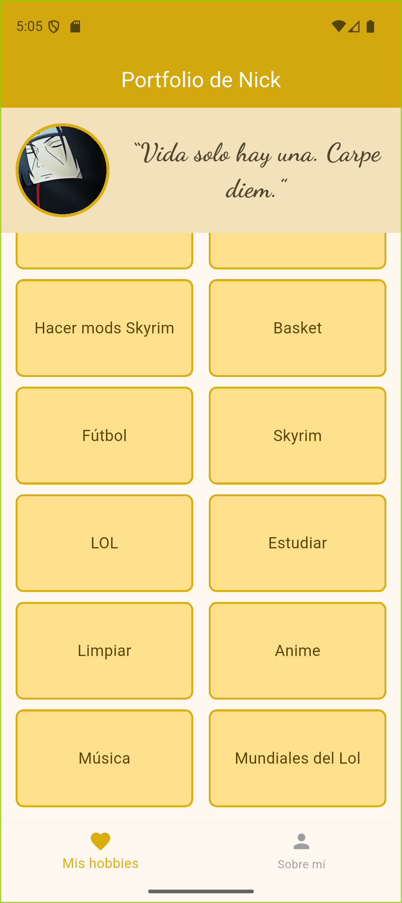
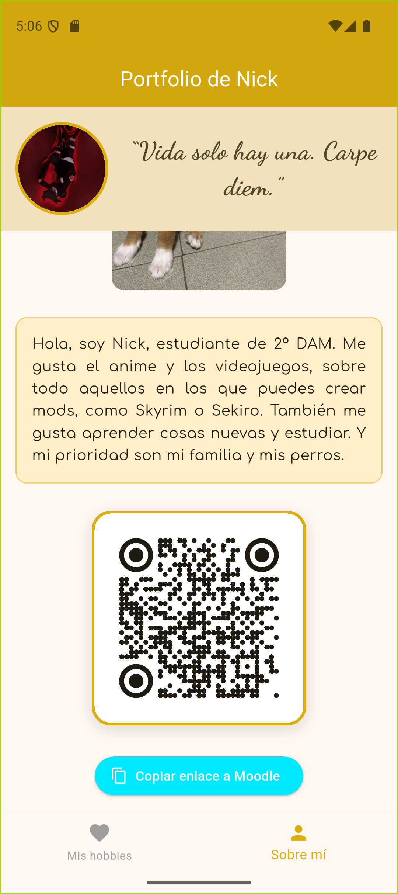

## Capturas

### Mis hobbies
Mis aficiones aparecen en una cuadrícula ordenada **de mayor a menor prioridad**: las primeras
tarjetas son las que más me importan y, conforme bajas, aparecen las demás.

### Mis hobbies (deslizando)
La cuadrícula se puede deslizar para ver el resto de hobbies. La cabecera con mi foto y la barra
inferior se quedan fijas.

### Sobre mí
Una breve presentación sobre mí junto a una foto de mis perros: la perrita marrón es **Nala** y el
negro es **Kaiser**.

### Sobre mí (deslizando)
Al deslizar aparece un código QR que lleva a la tarea en Moodle y un botón para copiar el enlace.
Al pulsarlo, se muestra un aviso confirmando que se ha copiado.

