# Easy Check

App de fichaje para los trabajadores de los hoteles de Canarias, desarrollada con Flutter
en el módulo de Programación Multimedia y Dispositivos Móviles (2.º DAM).

Este repositorio es el proyecto **PGL-P2-MyPortfolio**: la app se irá construyendo tarea a
tarea a partir del diseño realizado anteriormente.

| Ruta | Pantalla |
| --- | --- |
| `/` | Bienvenida |
| `/portfolio` | Portfolio: *Mis hobbies* y *Sobre mí* (se cambia con la barra inferior) |
| `/history` | Historial de fichajes (CRUD) |

## Tarea 1: Navegación

- Navegación con **go_router** mediante un **Drawer** (menú lateral).
- **Pantalla de bienvenida** con imagen de fondo, mensaje y botón para entrar.
- **Portfolio** de la tarea anterior, adaptado a la paleta de colores de Easy Check.

| Bienvenida | Menú lateral |
| :---: | :---: |
| 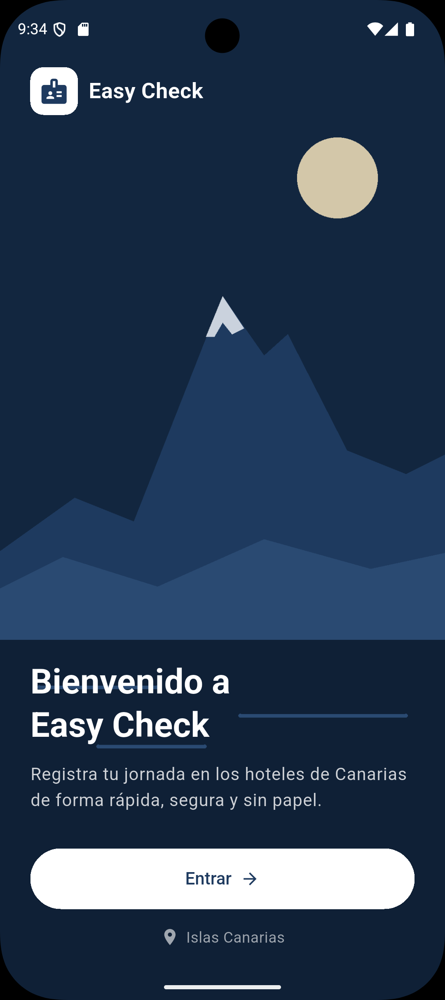 | 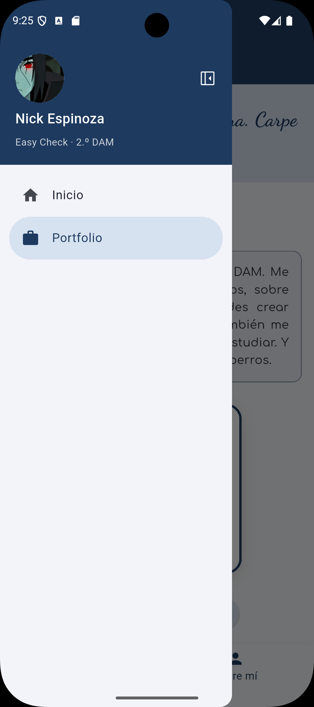 |

| Mis hobbies | Sobre mí |
| :---: | :---: |
| 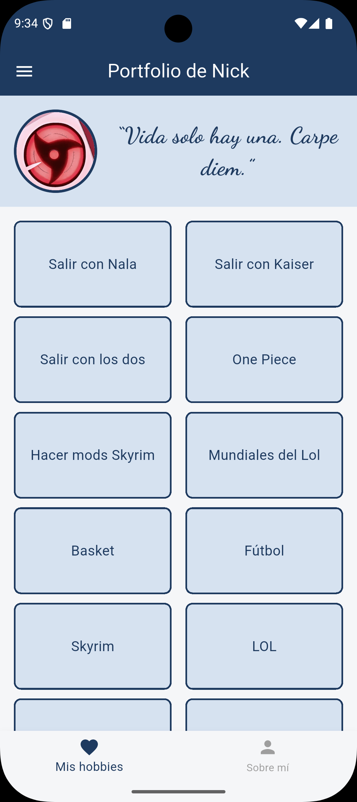 | 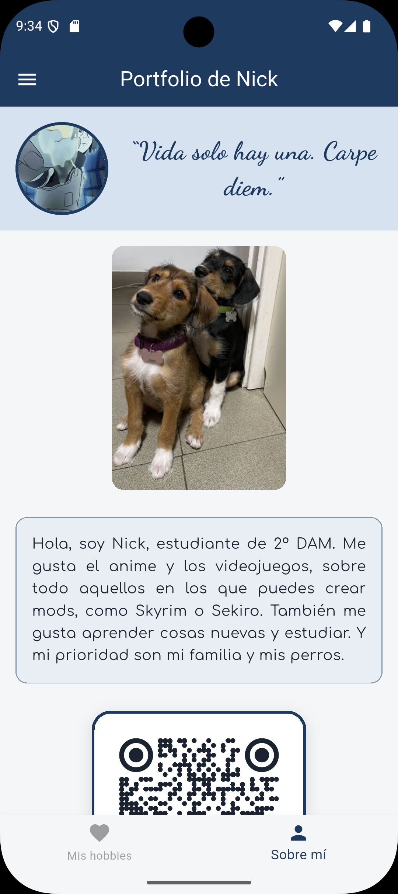 |

## Tarea 3: Formulario (historial de fichajes)

Pantalla CRUD del diseño: el historial de fichajes del trabajador, accesible desde el menú lateral.

- **Lista dinámica** de fichajes. Cada fichaje muestra el nombre del hotel, una descripción
  breve, la fecha, las horas trabajadas y el **icono de su tipo de hotel** (playa, rural,
  urbano o montaña).
- **Marcador** con el número total de fichajes y las horas totales, que se actualiza al
  añadir y al borrar.
- Botón **Añadir fichaje** que abre un **modal (Dialog)** con un formulario validado: nombre
  del hotel, descripción breve, **selector de tipo de hotel**, fecha y horas de entrada y
  salida. Los turnos de noche (por ejemplo, de 22:00 a 06:00) se calculan correctamente.
- **Papelera** en cada fichaje, con un modal de confirmación antes de borrar.
- Botón para **borrar todos los fichajes** desde la barra superior, también con
  confirmación. Se desactiva cuando la lista está vacía.

### Ver y añadir

| Historial | Añadir fichaje | Fichaje añadido |
| :---: | :---: | :---: |
| 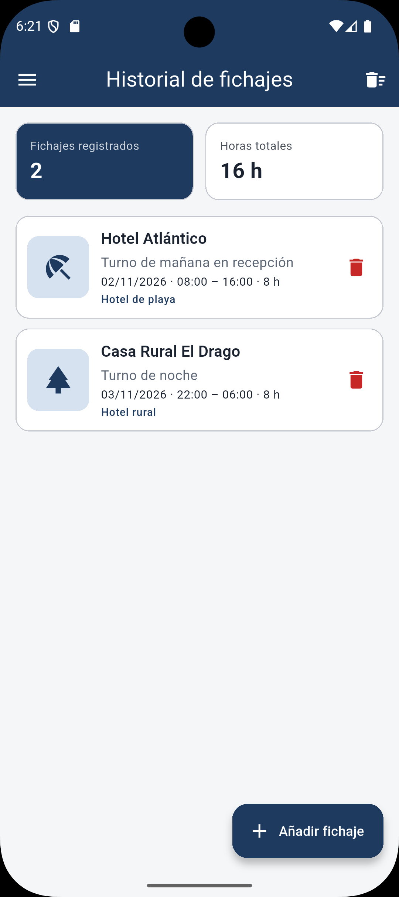 | 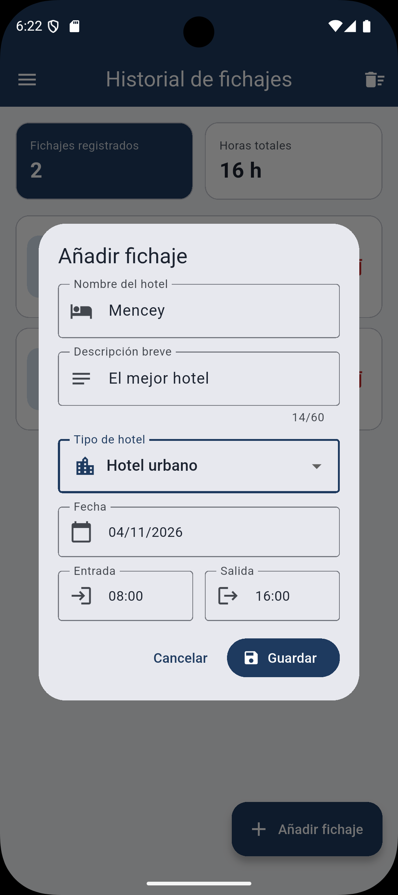 | 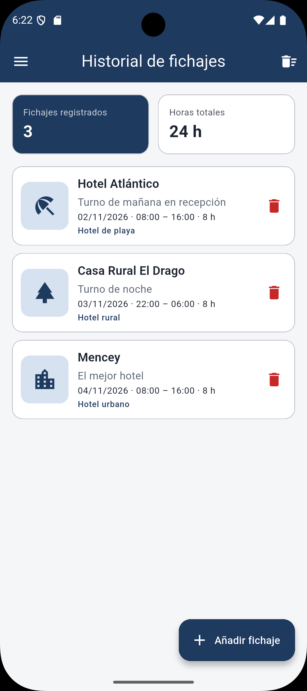 |

| Selector de tipo de hotel | Validación del formulario |
| :---: | :---: |
| 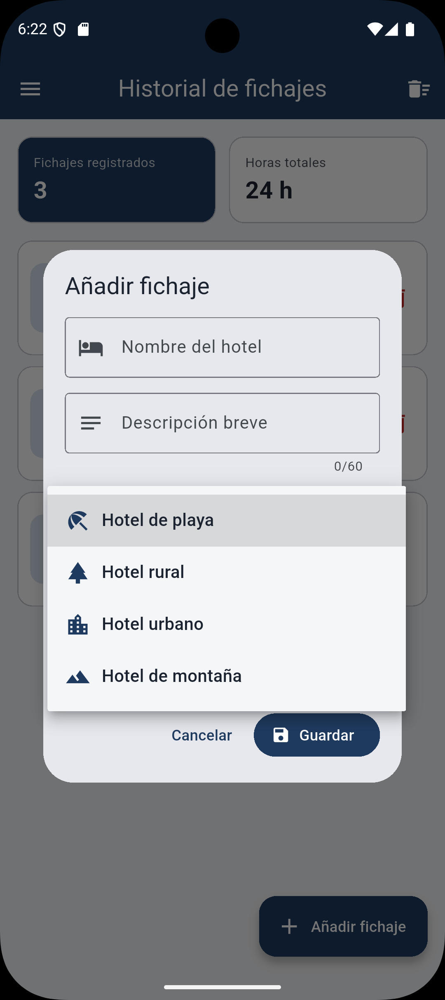 | 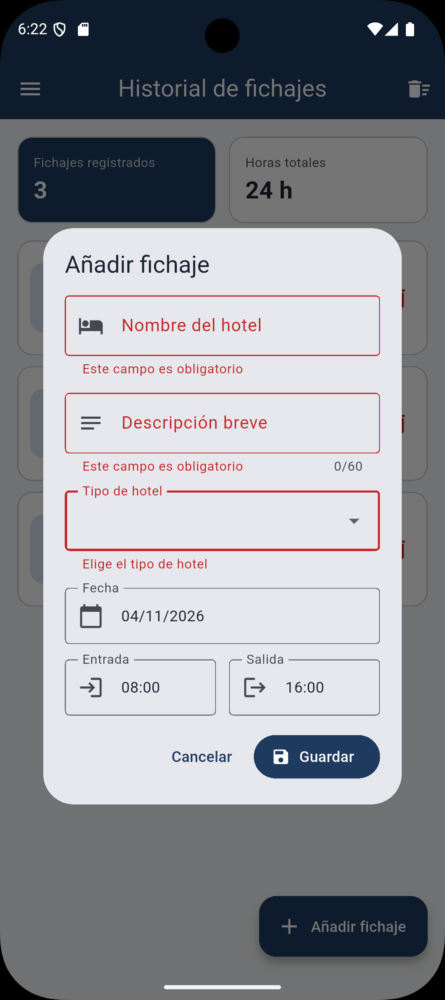 |

### Borrar

| Confirmar borrado | Fichaje borrado |
| :---: | :---: |
| 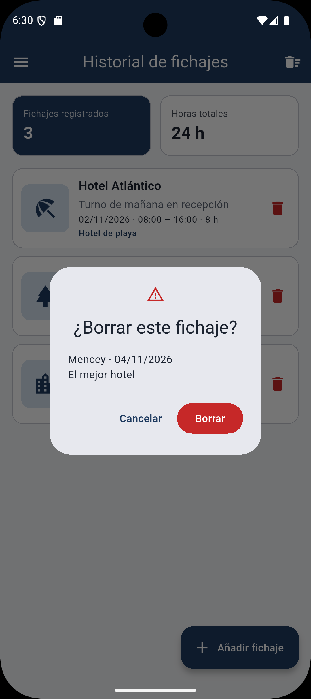 | 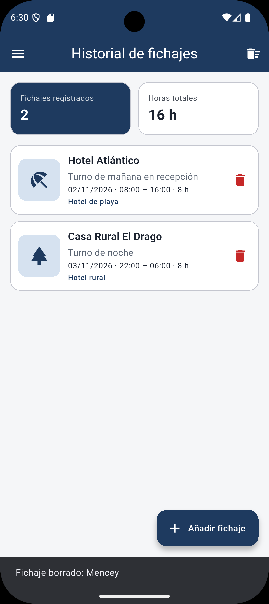 |

| Confirmar borrar todo | Historial vacío |
| :---: | :---: |
| 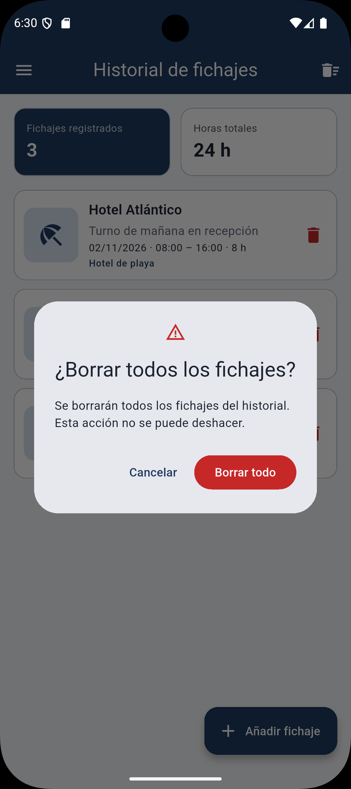 | 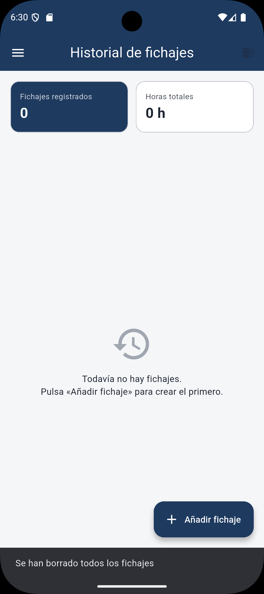 |

## Refactorización

Mejoras aplicadas a partir de las observaciones del profesor:

- **Textos divididos por pantalla.** El antiguo `app_strings.dart` se ha separado en una
  clase por pantalla (`DrawerStrings`, `HistoryStrings`…), más `CommonStrings` para los
  textos compartidos. Las rutas de las imágenes están en `AppAssets`.
- **Un componente por archivo.** Las clases privadas que había dentro de las pantallas
  ahora son widgets públicos con su propio archivo. Los que se pueden reutilizar en
  cualquier pantalla (`ConfirmDialog` y `PickerField`) están en `widgets/common/`. El resto
  está en la carpeta de su pantalla.

## Estructura del proyecto

```
lib/
├── main.dart                           # Arranque de la app (tema y router)
├── config/
│   ├── constants/
│   │   ├── app_assets.dart             # Rutas de las imágenes
│   │   └── strings/                    # Textos de la app, uno por pantalla
│   │       ├── common_strings.dart     # Textos compartidos
│   │       ├── drawer_strings.dart
│   │       ├── history_strings.dart
│   │       ├── portfolio_strings.dart
│   │       ├── record_form_strings.dart
│   │       └── welcome_strings.dart
│   ├── router/
│   │   ├── app_router.dart             # Configuración de go_router
│   │   └── app_routes.dart             # Rutas de la app
│   └── theme/
│       ├── app_colors.dart             # Paleta de colores
│       └── app_theme.dart              # Tema de la app
├── models/
│   ├── clock_record.dart               # Un fichaje
│   ├── drawer_item.dart                # Opción del menú lateral
│   └── hotel_type.dart                 # Tipos de hotel con su icono
├── utils/
│   └── formatters.dart                 # Formato de fechas, horas y duraciones
├── screens/
│   ├── history/history_screen.dart     # Historial de fichajes (CRUD)
│   ├── portfolio/portfolio_screen.dart
│   └── welcome/welcome_screen.dart
└── widgets/
    ├── common/                         # Widgets reutilizables
    │   ├── confirm_dialog.dart         # Modal de confirmación
    │   └── picker_field.dart           # Campo que abre un selector
    ├── drawer/                         # Menú lateral común
    │   ├── app_drawer.dart
    │   └── app_drawer_header.dart      # Cabecera con foto y nombre
    ├── history/                        # Widgets del historial
    │   ├── add_record_dialog.dart      # Modal para añadir un fichaje
    │   ├── clock_record_tile.dart      # Tarjeta de un fichaje
    │   ├── counter_card.dart           # Tarjeta del marcador
    │   ├── empty_history.dart          # Mensaje de lista vacía
    │   ├── hotel_type_dropdown.dart    # Selector del tipo de hotel
    │   └── record_counter.dart         # Marcador del total
    ├── portfolio/                      # Widgets del portfolio
    └── welcome/
        └── welcome_top_bar.dart        # Logo y nombre de la app
```

## Paquetes utilizados

- [go_router](https://pub.dev/packages/go_router): navegación entre pantallas.
- [material_symbols_icons](https://pub.dev/packages/material_symbols_icons): iconos de Material Symbols.
- [google_fonts](https://pub.dev/packages/google_fonts): tipografías del portfolio.
- [qr_flutter](https://pub.dev/packages/qr_flutter): código QR de la sección «Sobre mí».

## Flujo de trabajo con Git

- `main`: producto final. Solo recibe cambios desde `develop`.
- `develop`: rama de desarrollo, creada a partir de `main`.
- Una rama por tarea, creada a partir de `develop`: `P2-Tarea1-Navegación`,
  `P2-Tarea3-Formulario` y `P2-Refactor`.
- Al terminar cada tarea, su rama se mergea en `develop` y después `develop` en `main`.
- Los commits siguen el convenio **Karma** (`feat`, `fix`, `docs`, `style`, `refactor`…).

## Cómo ejecutarlo

```bash
flutter pub get
flutter run
```