# Easy Check

App de fichaje para los trabajadores de los hoteles de Canarias, desarrollada con Flutter
en el módulo de Programación Multimedia y Dispositivos Móviles (2.º DAM).

Este repositorio es el proyecto **PGL-P2-MyPortfolio**: la app se irá construyendo tarea a
tarea a partir del diseño realizado anteriormente.

| Ruta | Pantalla |
| --- | --- |
| `/login` | Inicio de sesión (pantalla inicial) |
| `/register` | Registro de usuario |
| `/` | Bienvenida |
| `/portfolio` | Portfolio: *Mis hobbies* y *Sobre mí* (se cambia con la barra inferior) |
| `/history` | Historial de fichajes (CRUD) |

## Tarea 1: Navegación

- Navegación con **go_router** mediante un **Drawer** (menú lateral).
- **Pantalla de bienvenida** con imagen de fondo, mensaje y botón para entrar.
- **Portfolio** de la tarea anterior, adaptado a la paleta de colores de Easy Check.

| Bienvenida | Menú lateral |
| :---: | :---: |
| 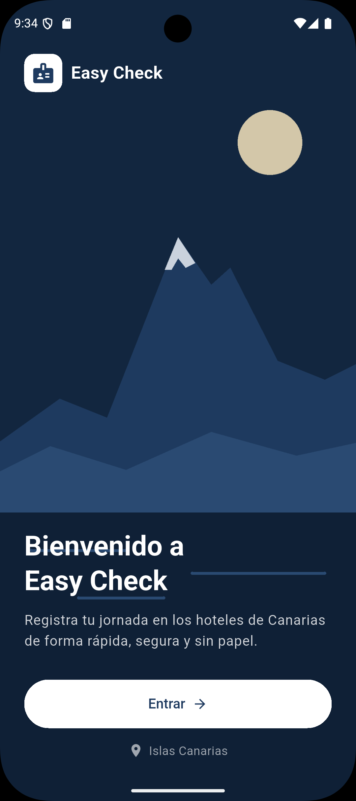 | 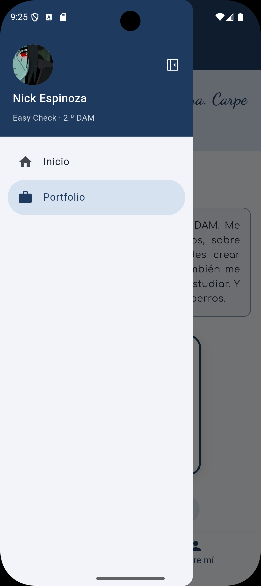 |

| Mis hobbies | Sobre mí |
| :---: | :---: |
| 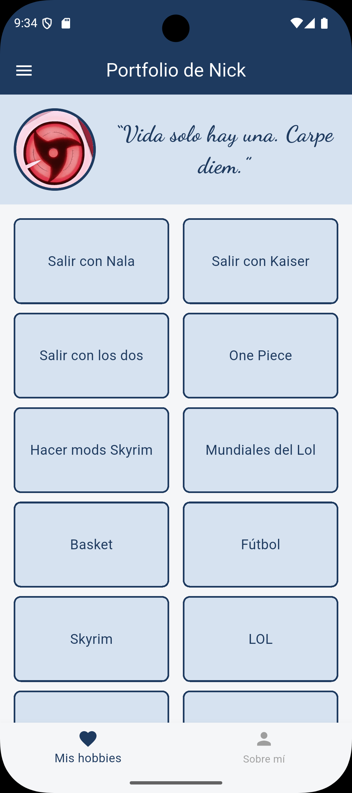 | 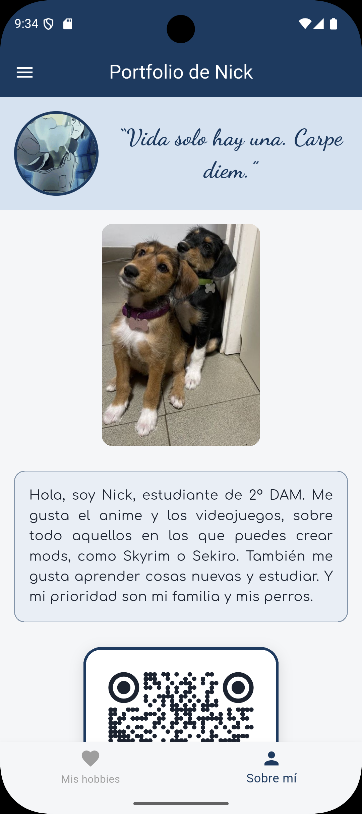 |

## Tarea 3: Formulario (historial de fichajes)

Pantalla CRUD del diseño: el historial de fichajes del trabajador, accesible desde el menú lateral.

- **Lista dinámica** de fichajes. Cada fichaje muestra el nombre del hotel, una descripción
  breve, la fecha, las horas trabajadas y el **icono de su tipo de hotel** (playa, rural,
  urbano o montaña).
- **Marcador** con el número total de fichajes y las horas totales, que se actualiza al
  añadir y al borrar.
- Botón **Añadir fichaje** que abre un **modal (Dialog)** con un formulario validado: nombre
  del hotel, descripción breve, **selector de tipo de hotel**, fecha y horas de entrada y
  salida. Los turnos de noche (por ejemplo, de 22:00 a 06:00) se calculan correctamente.
- **Papelera** en cada fichaje, con un modal de confirmación antes de borrar.
- Botón para **borrar todos los fichajes** desde la barra superior, también con
  confirmación. Se desactiva cuando la lista está vacía.

### Ver y añadir

| Historial | Añadir fichaje | Fichaje añadido |
| :---: | :---: | :---: |
| 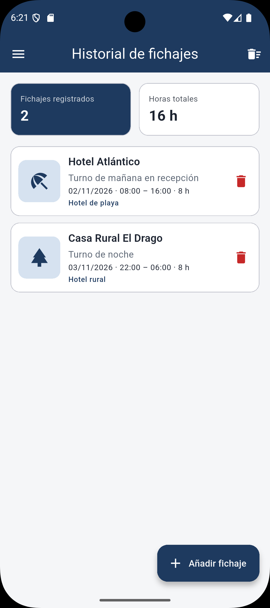 | 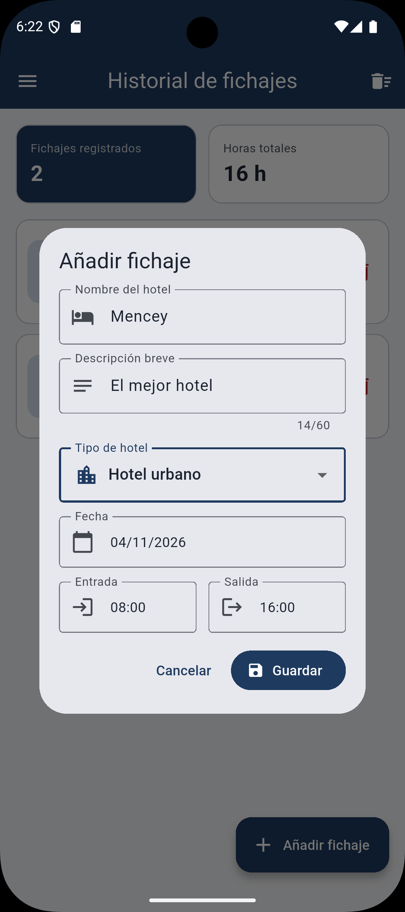 | 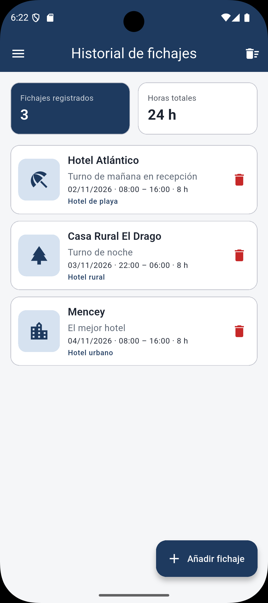 |

| Selector de tipo de hotel | Validación del formulario |
| :---: | :---: |
| 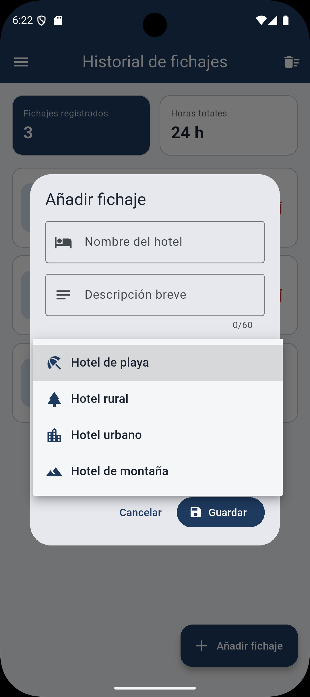 | 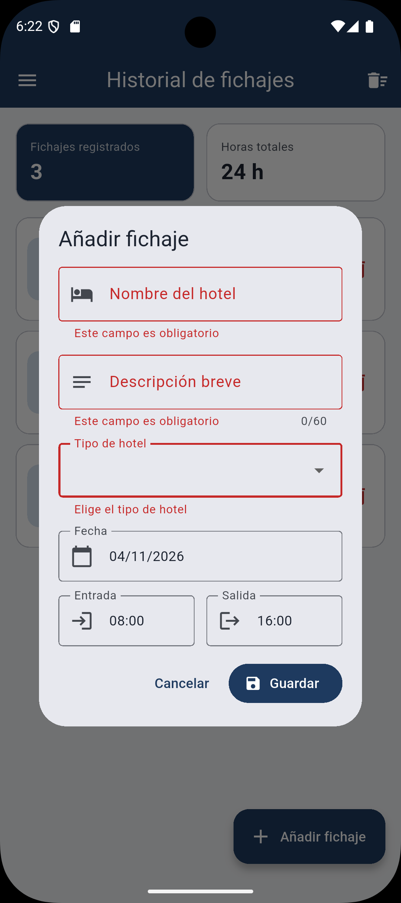 |

### Borrar

| Confirmar borrado | Fichaje borrado |
| :---: | :---: |
| 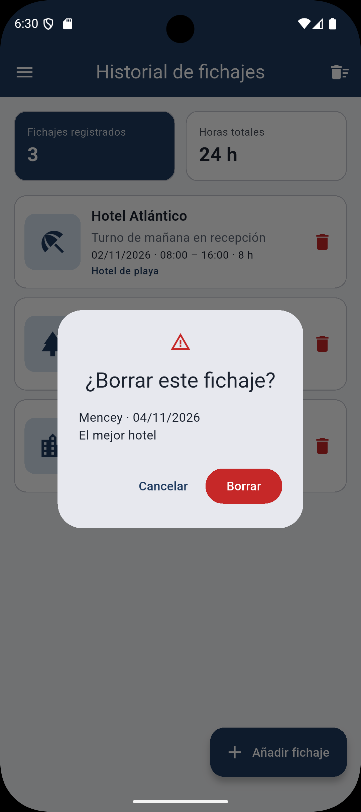 | 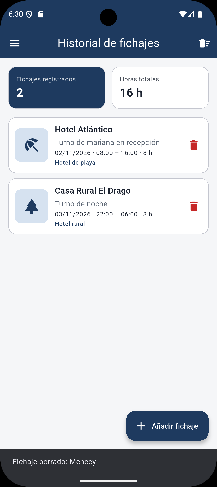 |

| Confirmar borrar todo | Historial vacío |
| :---: | :---: |
| 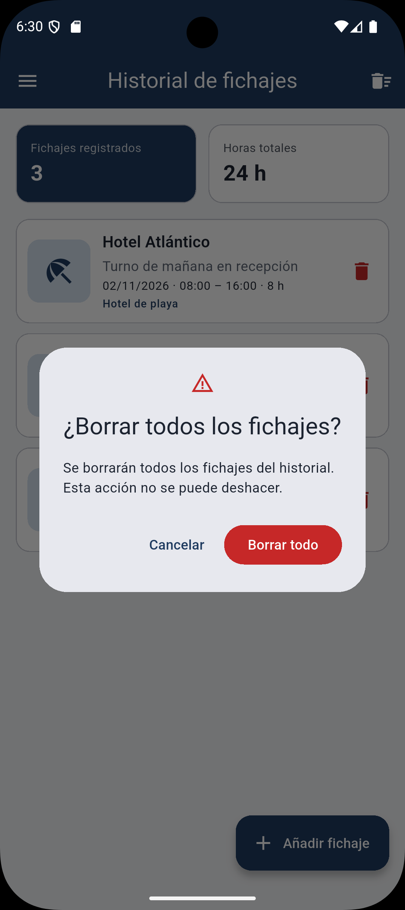 | 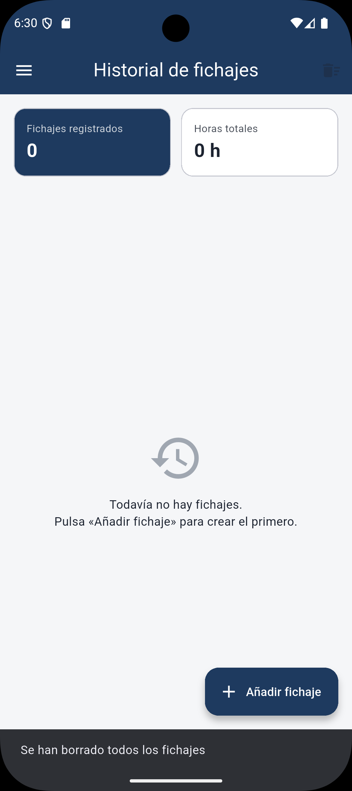 |

## Refactorización

Mejoras aplicadas a partir de las observaciones del profesor:

- **Textos divididos por pantalla.** El antiguo `app_strings.dart` se ha separado en una
  clase por pantalla (`DrawerStrings`, `HistoryStrings`…), más `CommonStrings` para los
  textos compartidos. Las rutas de las imágenes están en `AppAssets`.
- **Un componente por archivo.** Las clases privadas que había dentro de las pantallas
  ahora son widgets públicos con su propio archivo. Los que se pueden reutilizar en
  cualquier pantalla (`ConfirmDialog` y `PickerField`) están en `widgets/common/`. El resto
  está en la carpeta de su pantalla.

## Tarea 5: Sesión de usuario

Registro e inicio de sesión contra la API de usuarios del profesor
([my-users-api](https://github.com/adhernea/my-users-api)), que autentica con **tokens JWT**.

- **Pantalla de inicio de sesión**: email y contraseña, botón para iniciar sesión y botón para
  ir al registro. Es la **única pantalla al abrir la app** (sin Drawer).
- **Pantalla de registro**: nombre completo, email y contraseña. Tras un registro exitoso
  vuelve al inicio de sesión.
- **Alertas**: cualquier respuesta de la API se muestra en una alerta, con icono verde si ha
  ido bien y rojo si ha fallado.
- **Validación de los campos**: nombre con al menos un apellido, email con formato válido y,
  en el registro, contraseña segura (8 caracteres como mínimo, con mayúscula, minúscula,
  número y símbolo).
- **Token guardado de forma segura** con `flutter_secure_storage`, que lo cifra en el
  almacenamiento interno del móvil.
- **Sesión al iniciar la app**: si hay un token guardado, se comprueba en la API
  (`/users/check-token`) y, si sigue siendo válido, se entra directamente a la Bienvenida.
- **Rutas protegidas**: sin sesión, el router redirige siempre al inicio de sesión.
- **Cerrar sesión** desde el Drawer, con confirmación: borra el token y vuelve al inicio de
  sesión.
- Botón **Ver mensaje de bienvenida** en la pantalla de Bienvenida, que muestra la respuesta
  del endpoint `/users/welcome`.
- **Peticiones HTTP encapsuladas en servicios**: `AuthService` (registro, login, comprobar
  token, bienvenida y cierre de sesión) y `SecureStorageService` (guardar, leer y borrar el
  token). Las pantallas no hacen ninguna petición directamente.
- Las peticiones esperan hasta **90 segundos**, porque Render tarda alrededor de un minuto
  en reactivar la API si estaba en reposo.

### Registro

| Pantalla de registro | Validación | Registro exitoso |
| :---: | :---: | :---: |
| 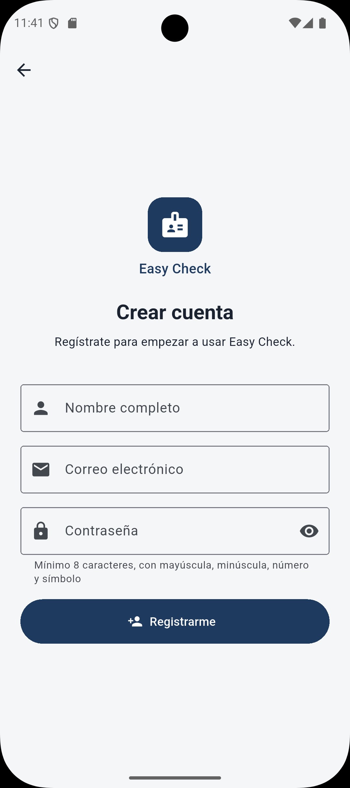 | 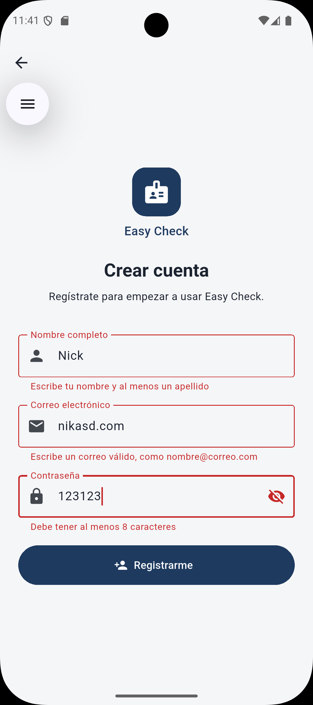 | 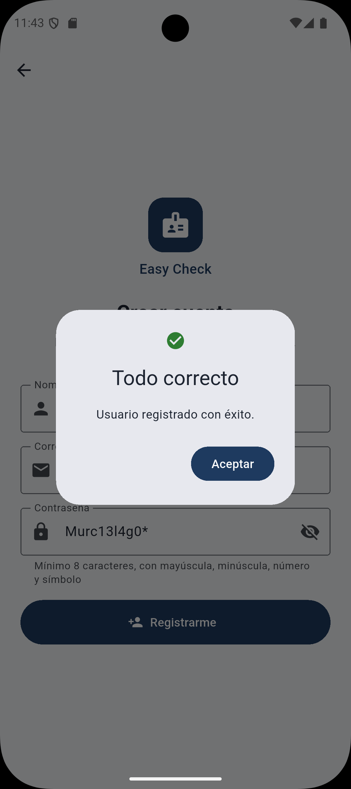 |

### Inicio de sesión

| Inicio de sesión | Login fallido | Login exitoso |
| :---: | :---: | :---: |
| 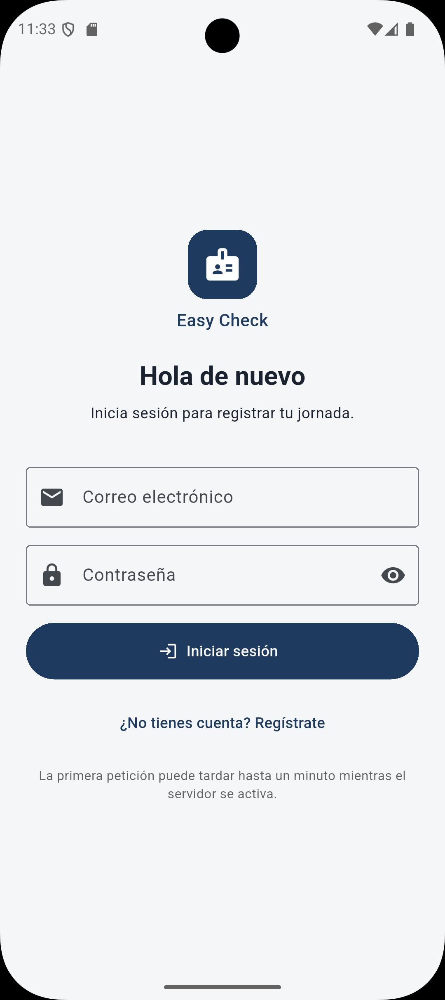 | 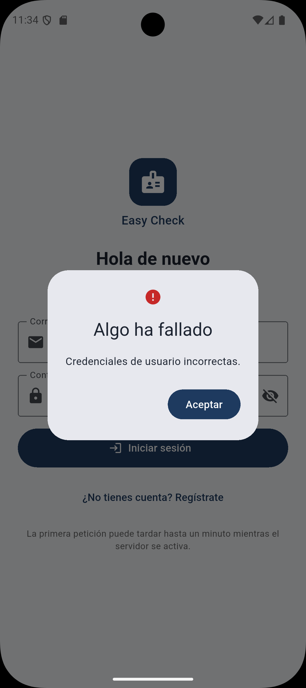 | 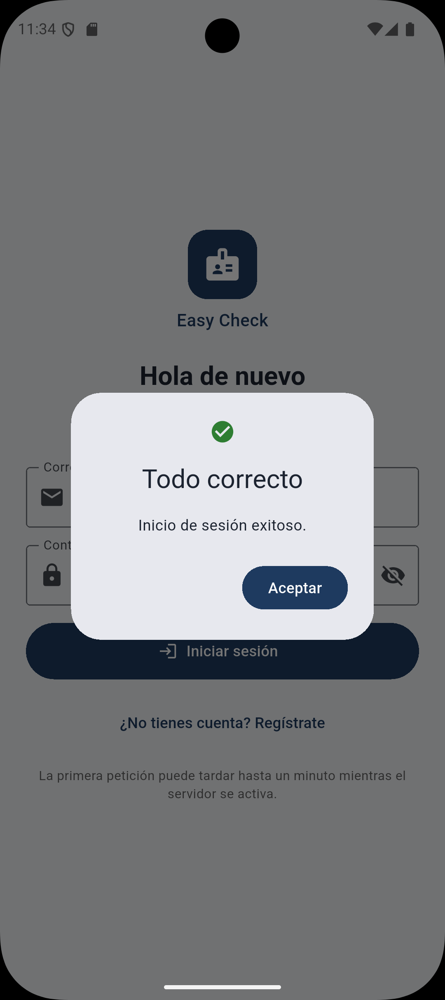 |

### Bienvenida y cierre de sesión

| Bienvenida | Mensaje de la API | Menú con cerrar sesión | Confirmar cierre |
| :---: | :---: | :---: | :---: |
| 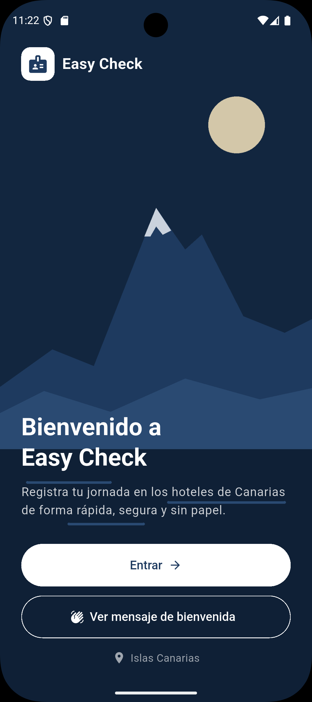 | 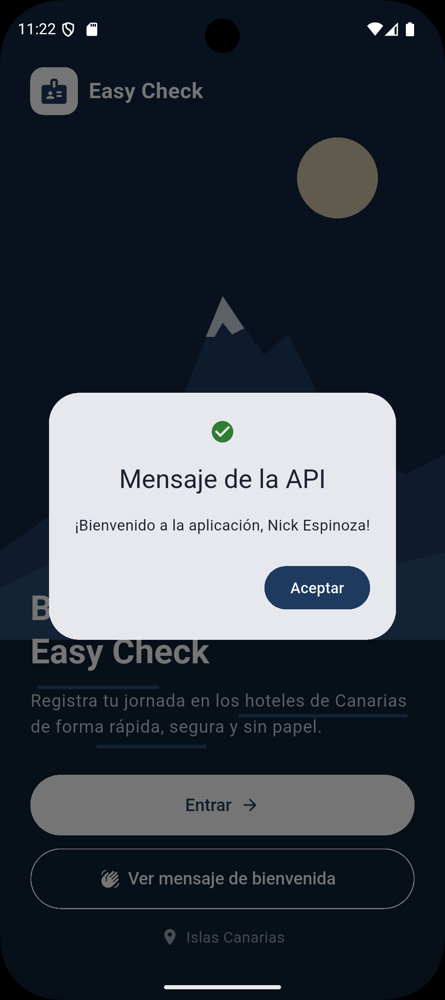 | 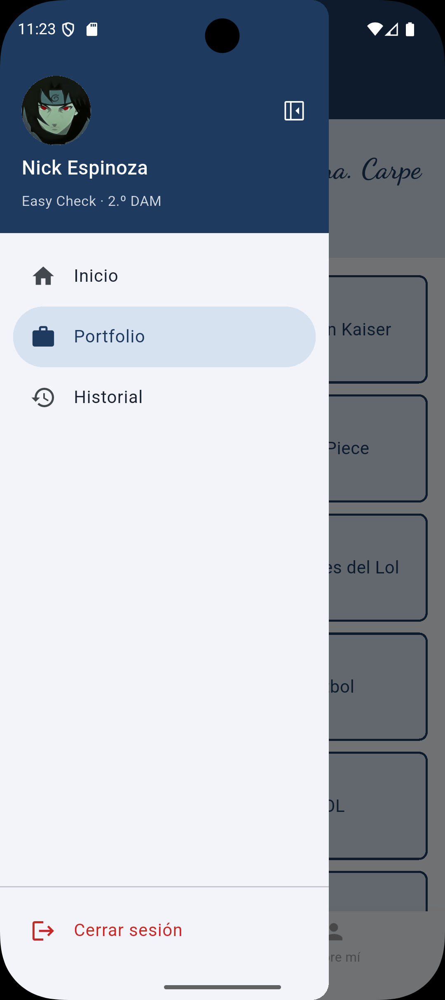 | 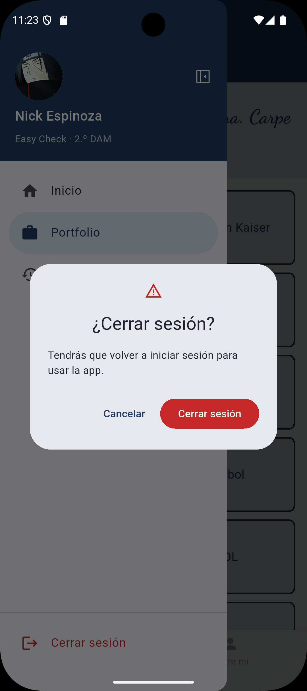 |

## Estructura del proyecto

```
lib/
├── main.dart                           # Arranque de la app (tema y router)
├── config/
│   ├── constants/
│   │   ├── api_endpoints.dart          # Direcciones de la API de usuarios
│   │   ├── app_assets.dart             # Rutas de las imágenes
│   │   └── strings/                    # Textos de la app, uno por pantalla
│   │       ├── auth_strings.dart       # Inicio de sesión y registro
│   │       ├── common_strings.dart     # Textos compartidos
│   │       ├── drawer_strings.dart
│   │       ├── history_strings.dart
│   │       ├── portfolio_strings.dart
│   │       ├── record_form_strings.dart
│   │       └── welcome_strings.dart
│   ├── router/
│   │   ├── app_router.dart             # go_router y protección de rutas
│   │   └── app_routes.dart             # Rutas de la app
│   └── theme/
│       ├── app_colors.dart             # Paleta de colores
│       └── app_theme.dart              # Tema de la app
├── models/
│   ├── api_response.dart               # Resultado de una llamada a la API
│   ├── clock_record.dart               # Un fichaje
│   ├── drawer_item.dart                # Opción del menú lateral
│   └── hotel_type.dart                 # Tipos de hotel con su icono
├── services/
│   ├── auth_service.dart               # Peticiones HTTP a la API de usuarios
│   └── secure_storage_service.dart     # Token guardado de forma segura
├── utils/
│   ├── formatters.dart                 # Formato de fechas, horas y duraciones
│   └── validators.dart                 # Validación de nombre, email y contraseña
├── screens/
│   ├── auth/
│   │   ├── login_screen.dart           # Inicio de sesión
│   │   └── register_screen.dart        # Registro de usuario
│   ├── history/history_screen.dart     # Historial de fichajes (CRUD)
│   ├── portfolio/portfolio_screen.dart
│   └── welcome/welcome_screen.dart
└── widgets/
    ├── auth/                           # Widgets del login y del registro
    │   ├── auth_header.dart            # Logo, título y subtítulo
    │   ├── email_field.dart            # Campo de email validado
    │   └── password_field.dart         # Campo de contraseña con botón para verla
    ├── common/                         # Widgets reutilizables
    │   ├── confirm_dialog.dart         # Modal de confirmación
    │   ├── loading_button.dart         # Botón con rueda de carga
    │   ├── message_dialog.dart         # Alerta con la respuesta de la API
    │   └── picker_field.dart           # Campo que abre un selector
    ├── drawer/                         # Menú lateral común
    │   ├── app_drawer.dart             # Opciones y cerrar sesión
    │   └── app_drawer_header.dart      # Cabecera con foto y nombre
    ├── history/                        # Widgets del historial
    │   ├── add_record_dialog.dart      # Modal para añadir un fichaje
    │   ├── clock_record_tile.dart      # Tarjeta de un fichaje
    │   ├── counter_card.dart           # Tarjeta del marcador
    │   ├── empty_history.dart          # Mensaje de lista vacía
    │   ├── hotel_type_dropdown.dart    # Selector del tipo de hotel
    │   └── record_counter.dart         # Marcador del total
    ├── portfolio/                      # Widgets del portfolio
    └── welcome/
        ├── welcome_message_button.dart # Botón con el mensaje de la API
        └── welcome_top_bar.dart        # Logo y nombre de la app
```

## Paquetes utilizados

- [go_router](https://pub.dev/packages/go_router): navegación entre pantallas.
- [material_symbols_icons](https://pub.dev/packages/material_symbols_icons): iconos de Material Symbols.
- [google_fonts](https://pub.dev/packages/google_fonts): tipografías del portfolio.
- [qr_flutter](https://pub.dev/packages/qr_flutter): código QR de la sección «Sobre mí».
- [http](https://pub.dev/packages/http): peticiones a la API de usuarios.
- [flutter_secure_storage](https://pub.dev/packages/flutter_secure_storage): almacenamiento cifrado del token de sesión.

## Flujo de trabajo con Git

- `main`: producto final. Solo recibe cambios desde `develop`.
- `develop`: rama de desarrollo, creada a partir de `main`.
- Una rama por tarea, creada a partir de `develop`: `P2-Tarea1-Navegación`,
  `P2-Tarea3-Formulario`, `P2-Refactor` y `P2-Tarea5-SesionUsuario`.
- Al terminar cada tarea, su rama se mergea en `develop` y después `develop` en `main`.
- Los commits siguen el convenio **Karma** (`feat`, `fix`, `docs`, `style`, `refactor`…).

## Cómo ejecutarlo

```bash
flutter pub get
flutter run
```