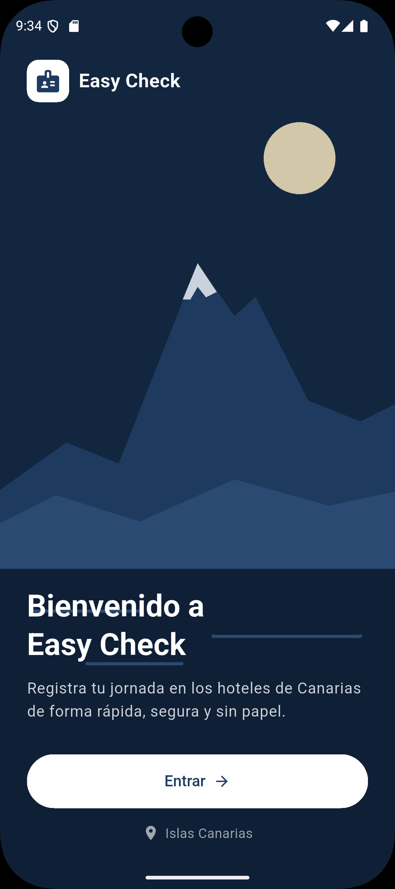
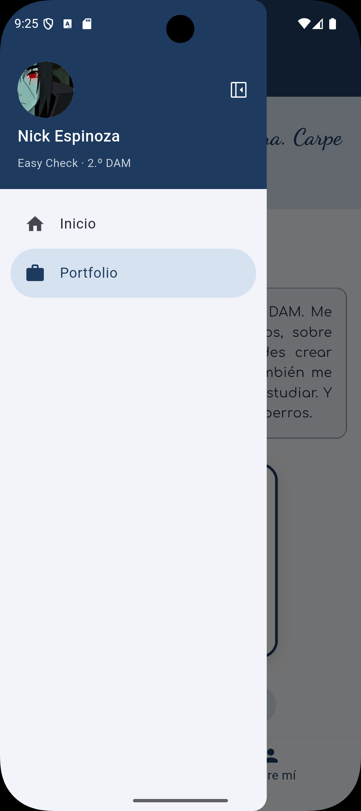
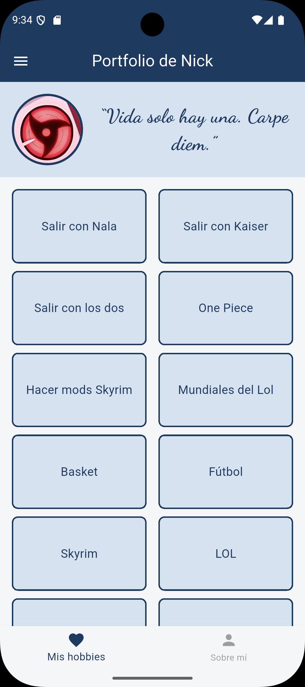
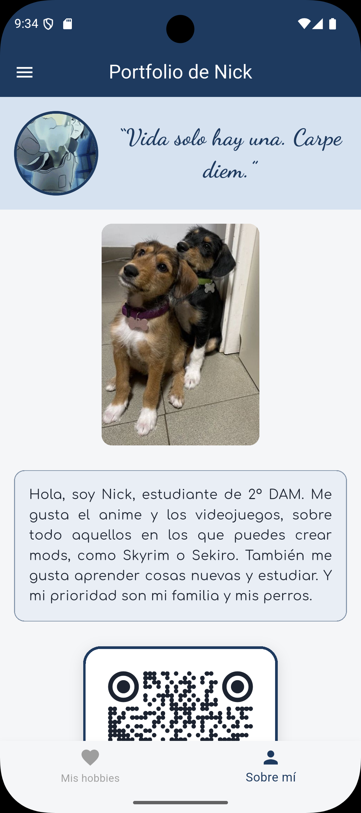

# Easy Check

App de fichaje para los trabajadores de los hoteles de Canarias, desarrollada con Flutter
en el módulo de Programación Multimedia y Dispositivos Móviles (2.º DAM).

Este repositorio es el proyecto **PGL-P2-MyPortfolio**: la app se irá construyendo tarea a
tarea a partir del diseño realizado anteriormente.

## Tarea 1: Navegación

- Navegación con **go_router** mediante un **Drawer** (menú lateral).
- **Pantalla de bienvenida** con imagen de fondo, mensaje y botón para entrar.
- **Portfolio** de la tarea anterior, adaptado a la paleta de colores de Easy Check.

| Ruta | Pantalla |
| --- | --- |
| `/` | Bienvenida |
| `/portfolio` | Portfolio: *Mis hobbies* y *Sobre mí* (se cambia con la barra inferior) |

## Capturas

| Bienvenida | Menú lateral |
| :---: | :---: |
|  |  |

| Mis hobbies | Sobre mí |
| :---: | :---: |
|  |  |

## Estructura del proyecto

```
lib/
├── main.dart                        # Arranque de la app (tema y router)
├── config/
│   ├── constants/app_strings.dart   # Textos, imágenes y enlaces
│   ├── router/
│   │   ├── app_router.dart          # Configuración de go_router
│   │   └── app_routes.dart          # Rutas de la app
│   └── theme/
│       ├── app_colors.dart          # Paleta de colores
│       └── app_theme.dart           # Tema de la app
├── models/
│   └── drawer_item.dart             # Opción del menú lateral
├── screens/
│   ├── portfolio/portfolio_screen.dart
│   └── welcome/welcome_screen.dart
└── widgets/
    ├── app_drawer.dart              # Menú lateral común
    └── portfolio/                   # Widgets del portfolio
```

## Paquetes utilizados

- [go_router](https://pub.dev/packages/go_router): navegación entre pantallas.
- [material_symbols_icons](https://pub.dev/packages/material_symbols_icons): iconos de Material Symbols.
- [google_fonts](https://pub.dev/packages/google_fonts): tipografías del portfolio.
- [qr_flutter](https://pub.dev/packages/qr_flutter): código QR de la sección «Sobre mí».

## Flujo de trabajo con Git

- `main`: producto final. Solo recibe cambios desde `develop`.
- `develop`: rama de desarrollo, creada a partir de `main`.
- `P2-Tarea1-Navegación`: rama de esta tarea, creada a partir de `develop`.
- Los commits siguen el convenio **Karma** (`feat`, `fix`, `docs`, `style`, `refactor`…).

## Cómo ejecutarlo

```bash
flutter pub get
flutter run
```
